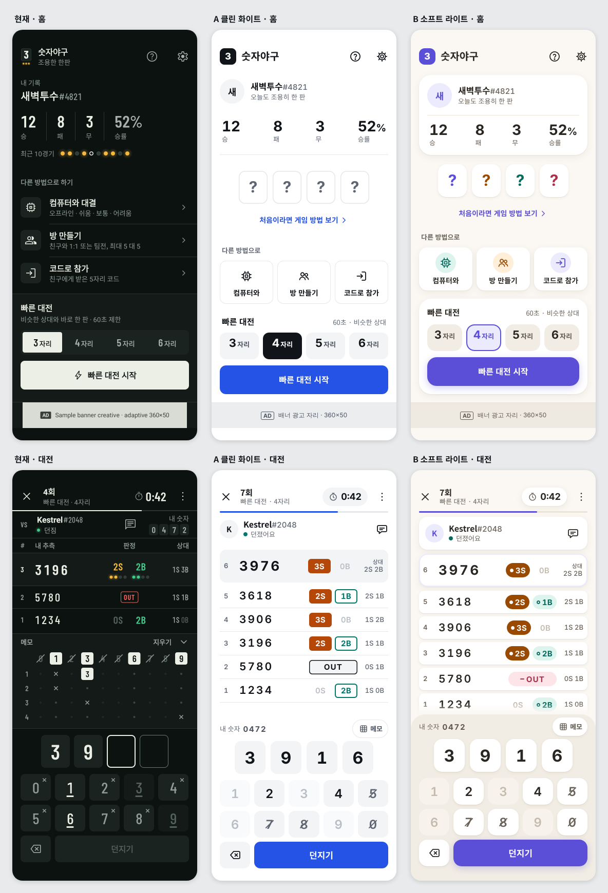

# 밝고 단순한 화면으로: 리디자인 제안 / Light, simple redesign proposal

Status: **decided 2026-11-26: Direction A "Clean white".** Turned into design system v2: [`../DESIGN_SYSTEM.md`](../DESIGN_SYSTEM.md), [`../tokens.json`](../tokens.json) 2.0.0, [`../REDESIGN_V2.md`](../REDESIGN_V2.md); the reference shots in `../shots/` are regenerated from `../prototype/`. This file and `proto.html` stay as the decision record (one deviation: zero counts use `text3`, not `disabled`, so all text passes AA).
Files: prototype `proto.html` (`?dir=A|B&screen=home|match|result&fs=1|2`), renderer `shoot.js`, contrast check `contrast.js`, PNGs in this folder.

---

## 한국어 요약

### 왜 지금 화면이 어수선해 보이나요

밤 야구장 전광판 콘셉트 자체는 일관되지만, **한 화면에 같은 무게의 정보가 너무 많고**, 검은 바탕 위의 회색 글씨, 가는 선, 띠(band)가 겹쳐 "정리가 안 된" 느낌을 줍니다. 화면별로 보면:

| 화면 | 어수선한 이유 (실제 앱 스크린샷 기준) |
| --- | --- |
| 홈 | 정보 층이 5개(브랜드 / 기록 숫자 + 세로 구분선 / 최근 10경기 점 / "다른 방법으로 하기" 목록 / 빠른 대전 띠 + 광고)라서 눈이 갈 곳이 없습니다. 목록마다 부제(오프라인 · 쉬움 · 보통 · 어려움…)가 붙어 글자가 많고, 가장 중요한 "빠른 대전 시작"이 흰 버튼이긴 하지만 바로 위 자리 수 선택과 제목·부제와 경쟁합니다. 최근 10경기 점은 색 점 10개라 의미를 바로 읽기 어렵습니다. |
| 대전 | 한 화면에 상단 바, VS 띠(상대·채팅·내 숫자), 표 머리글(# 내 추측 판정 상대), 기록, **10×5 메모판**, 입력 칸, 키패드가 모두 들어갑니다. 메모판이 화면의 약 4분의 1을 차지해 기록은 3줄만 보이고, 키패드에도 × 표시가 겹쳐 메모 정보가 두 군데 나옵니다. 램프 점, 0S 같은 회색 숫자, 가는 선이 많아 "보는 것"보다 "해석하는 것"이 먼저입니다. |
| 결과 | 승리 문구 아래에 상대 숫자, 내 숫자, **회별 스트라이크 표(2줄 × 6회 + 최고)**, 시간까지 모두 펼쳐져 있습니다. 표는 궁금한 사람만 보면 되는 정보인데 버튼보다 먼저 시선을 끕니다. 위쪽 갈색 그라데이션과 "광고 제거"가 상단 바에 있어 상단도 복잡합니다. |
| 설정 | 아이콘 + 제목 + 부제 + 스위치 + 슬라이더가 줄마다 있고 구분선이 들쭉날쭉(어떤 줄은 선, 어떤 줄은 여백)해서 리듬이 깨집니다. |
| 친구 방 | 코드 판, 복사/공유, 설정 띠, 인원 점, 팀 카드 6칸, 연습 버튼, 채팅 띠가 한 화면에 쌓여 있고 테두리 종류(실선, 왼쪽 색 띠, 빈 칸 테두리)가 3가지입니다. |
| 게임 방법·비밀 숫자 | 판정 설명 줄과 빈 기록 머리글이 비어 있는 큰 검은 영역과 함께 나와 "덜 만든 화면"처럼 보입니다. |

공통 원인: (1) 모든 것을 한 번에 보여 줌, (2) 강조 수단이 너무 많음(색 램프, 굵기, 선, 띠, 테두리), (3) 검은 바탕에서는 회색 단계가 많아질수록 흐릿하고 답답해 보임, (4) 좁은 고딕 숫자(Barlow Condensed)가 전광판 느낌은 주지만 촘촘하고 딱딱함.

### 잘 되는 캐주얼·퍼즐 게임들의 공통 원칙 (특정 게임을 베끼지 않고 원칙만)

밝은 바탕 · 화면마다 주 버튼 하나 · 넉넉한 여백 · 크고 읽기 쉬운 숫자 · 색은 적게(의미 있는 곳만) · 부드럽게 둥근 모양 · 테두리와 선 최소화 · 필요할 때만 보여 주기(점진적 공개).

### 두 가지 방향

**A. 클린 화이트** — 흰 바탕(#FFFFFF), 검은 글씨, 강조색은 파랑 하나(#2453E6). 그림자 없음, 평면. 가장 단정하고 숫자가 가장 또렷합니다.
**B. 소프트 라이트** — 따뜻한 미색 바탕(#FBF8F3), 하얀 카드에 아주 옅은 그림자, 보라 강조색(#5B4FD8)과 주황·청록 보조색. 더 친근하고 "게임 같은" 느낌.

두 방향 모두 바꾼 것:
- **홈**: 기록은 숫자 4개만(최근 10경기 점, 부제 삭제), 다른 모드는 아이콘 타일 3개, 맨 아래 엄지 자리에 "자리 수 + 빠른 대전 시작" 하나만 크게. 빈 자리에는 "? ? ? ?" 판과 "처음이라면 게임 방법 보기" 링크(초보자 안내).
- **대전**: 메모판을 화면에서 빼고 "메모" 버튼(시트로 열림)으로. 제외한 숫자는 키패드에 사선으로만 표시. 표 머리글 삭제, 최신 기록만 크게 강조, 6회 기록이 한 화면에 다 보입니다. 상대 판정은 작은 회색 글씨로. 타이머는 알약 모양 + 얇은 진행 막대. 내 숫자는 입력 칸 위 한 줄.
- **판정 표시**: S = 꽉 찬 칩(주황), B = 테두리 칩(청록), OUT = 회색/분홍 칩에 "OUT" 글자. 색 + 글자 + 모양 3중 단서라 색약도 구분됩니다. 0인 값은 흐리게.
- **결과**: 승리 · 상대 숫자 · 요약 3개(걸린 회, 시간, 내 기록)만. 회별 표는 "회별 기록 보기"로 접음. "광고 제거"는 상단에서 빼서 광고 바로 위 작은 글씨로.
- 광고는 홈·결과의 아래 배너 자리만, 대전 화면에는 없음(기존 규칙 그대로).
- 숫자 글꼴: Barlow Condensed(좁은 전광판 글꼴) → **Inter**(SIL OFL 1.1, 고정폭 숫자). 밝은 바탕에서 더 부드럽고 큼직하게 읽힙니다.
- 글자 200 %에서도 동작(A-match-font200.png): 숫자는 기존 규칙대로 1.3배까지만 커지고, 상단 부제는 숨기고, 상대 판정은 줄을 바꿔 아래로.

### 추천

**A(클린 화이트)를 기본으로 추천합니다.** "흰 바탕, 단순하게"라는 요청에 가장 정확히 맞고, 그림자·카드가 없어 작은 창과 큰 글씨에서도 무너질 곳이 적으며 개발 변경도 가장 작습니다(색 토큰과 몇 개 컴포넌트). B의 장점(홈의 색 아이콘 원, 결과의 트로피)은 나중에 A 위에 얹을 수 있습니다. 어두운 테마는 없애지 않고, 시스템 다크 모드일 때만 쓰는 선택지로 남깁니다(기본값은 밝은 테마).

---

## English

### 1. What makes the current design feel cluttered

The night-scoreboard concept is consistent, but every screen shows **too many things at the same visual weight**, and on a near-black background the many grey levels, hairlines and bands read as noise. Concretely (from the real app renders in `android/app/screenshots/`):

- **Home (`home-ko`)**: five stacked layers (brand, record with vertical dividers, 10-match form dots, "other ways to play" list, quick-match band with title + subtitle + segmented control + button, ad). Every list row has a subtitle. The form dots are ten coloured dots whose meaning is not readable at a glance. The primary button competes with the section title, subtitle and segmented control right above it.
- **Match (`match-guess-ko`)**: top bar, VS strip (opponent, chat, my secret plates), table header, log, a **10 × 5 memo board** (about a quarter of the screen), slots and keypad, all at once. The memo board pushes the log down to three rows, and the keypad repeats the memo as × marks, so the same information appears twice. Lamp dots, grey zero counts (`0S`) and hairlines make the player decode before they can read.
- **Result (`result-win-ko`)**: headline, opponent number, my number, a **per-inning strike table** (2 rows × 6 innings + best) and time all expanded. The table is optional information but pulls the eye before the buttons. The amber wash plus "광고 제거" in the top bar crowd the top.
- **Settings (`settings-ko`)**: icon + title + subtitle + switch + slider per row, and dividers that appear on some rows but not others, so the rhythm breaks.
- **Lobby (`lobby-ko`)**: code plates, copy/share, settings band, seat dots, six team cards, practice button and chat band in one column, with three different border treatments (outline, coloured left stripe, empty-seat border).
- **Tutorial / secret entry (`tutorial-2-ko`, `match-secret-ko`)**: an empty table header and a large empty black area make the screen look unfinished.

Root causes: everything shown at once; too many emphasis tools (lamp colour, weight, hairlines, bands, borders); dark UI with many grey steps reads muddy; the condensed numeral face is tight and technical.

### 2. Principles taken from successful casual/puzzle games (principles only, no specific look copied)

Light surfaces; one obvious primary action per screen, in the thumb zone; generous spacing; big, readable numbers; very few colours, used only for meaning; soft rounded shapes; minimal chrome (few lines and borders); progressive disclosure (show detail only when asked).

### 3. What both directions change

| Area | Change |
| --- | --- |
| Home | Record = four numbers only (form dots and row subtitles removed). Other modes = three icon tiles. One large "자리 수 + 빠른 대전 시작" block at the bottom (thumb zone). The space left over shows "? ? ? ?" plates and a "처음이라면 게임 방법 보기" link for beginners. Banner stays at the bottom. |
| Match | Memo board moved off-screen into a "메모" button (opens the existing memo sheet). Ruled-out digits are marked on the keypad only (diagonal stroke). No table header; the latest row is the only highlighted one; all 6 rounds fit at 360 × 800. Opponent hints are small grey text, labelled "상대" only on the latest row. Timer = pill + thin progress line. "내 숫자" is one line above the slots. Chat stays one tap away in the opponent row. No ads. |
| Hints | S = **solid** chip, B = **outlined** chip (B: tinted pill with ring dot), OUT = neutral/rose chip with the word `OUT` spanning both columns. Colour + letter + shape, so no colour is needed to read them. Zero counts are faint. |
| Result | Headline, opponent's number, three summary numbers (rounds, time, my record), "회별 기록 보기" link for the inning table. "광고 제거" moved from the top bar to a quiet line above the banner. Primary "다시 하기", secondary "홈으로". |
| Numerals | Barlow Condensed → **Inter** (SIL OFL 1.1), tabular figures. Wider, friendlier digits on a light background; same 1.3× cap at large font scale. |
| Font 200 % | `A-match-font200.png`: words at 2.0×, digits capped at 1.3× (DESIGN_SYSTEM 3.3 rule kept), top-bar subtitle hidden, opponent hint wraps under the guess, log keeps latest + 2 rows and scrolls. |
| Dark | Light is the default. A dark palette stays as an option that follows the **system** dark mode (to be derived from these tokens later; the current night palette is a good starting point). |

### 4. Direction A: "Clean white"

Near-white, black text, one accent, flat (no shadows). Square-ish 12 dp radius.

| Token | Hex | Use | Contrast (WCAG 2.x) |
| --- | --- | --- | --- |
| `bg` | `#FFFFFF` | Window | — |
| `surface` | `#F3F4F6` | Keys, slots, latest log row, chips | — |
| `line` | `#E5E7EB` | Dividers, tile borders (decorative) | — |
| `outline` | `#7E8693` | Empty slot boundary | 3.67 on bg (≥ 3 UI) |
| `ink` | `#111418` | Text, OUT text, answer plates | 18.47 bg / 16.78 surface |
| `text2` | `#4B5260` | Secondary text | 7.85 bg / 7.13 surface |
| `text3` | `#5F6673` | Captions, round numbers, opponent hints | 5.78 bg / 5.25 surface |
| `accent` | `#2453E6` | Primary button, selection, progress, links | 6.08 bg; white on accent 6.08 |
| `strike` | `#B54708` | S chip fill (white text) | white on strike 5.43; on bg 5.43 |
| `ball` | `#00796B` | B chip outline + text | 5.32 on bg |
| `out` | `#111418` on `#F3F4F6` | OUT chip | 16.78 |
| `disabled` | `#B9BEC6` | Used keys, zero counts (`0B`) | exempt (see 6) |
| Ad band | `#4B5260` on `#ECEDEF` | Banner placeholder label | 6.70 |

Type (sans = system: Noto Sans CJK KR / Roboto, 400 and 700): display 40/48, title 20/28, subtitle 16/22, body 15/22, label 16/20, caption 13/18. Numerals (Inter 600–700, tabular): slot 32, latest log 26, log 21, keypad 24, stat 28, timer 18, hint 15, tag 15. Radius: 6 chips, 12 keys/slots/buttons/tiles, 16 sheets. Spacing: 4 dp grid, 16 dp margin, 8 dp gaps between keys and tiles, 56 dp primary buttons, 52 dp keys.

### 5. Direction B: "Soft light"

Warm off-white, white cards with a soft shadow, a slightly playful palette (indigo accent, amber and teal accents on tiles), pills.

| Token | Hex | Use | Contrast |
| --- | --- | --- | --- |
| `bg` | `#FBF8F3` | Window | — |
| `surface` | `#FFFFFF` | Cards, keys, log rows | — |
| `sunk` | `#F2EDE4` | Keypad panel, unselected digit chips | — |
| `line` | `#EAE3D8` | Dividers (decorative) | — |
| `outline` | `#857D71` | Empty slot boundary | 3.83 bg / 3.48 sunk |
| `ink` | `#2A2622` | Text | 14.17 bg / 15.01 surface / 12.87 sunk |
| `text2` | `#5E574F` | Secondary | 6.71 bg / 6.10 sunk |
| `text3` | `#6A6258` | Captions | 5.66 bg / 5.14 sunk |
| `accent` | `#5B4FD8` | Primary button, selection, links | 5.58 bg; white on accent 5.91; on accentTint 4.99 |
| `strike` | `#9A4A00` | S pill fill (white text), result plates text | white on strike 6.26; on strikeTint 5.55 |
| `ball` | `#066B5D` on `#DDF3EE` | B pill | 5.55 |
| `out` | `#A8304A` on `#FCE4E8` | OUT pill | 5.46 |
| Tints | `#FFEFD9` `#DDF3EE` `#ECEAFD` `#FCE4E8` | Tile icon circles, pills, plates | decorative |
| Shadow | `0 1px 2px rgba(74,52,28,.06), 0 4px 14px rgba(74,52,28,.07)` | Cards | — |

Type: same scale as A. Radius: 10 log rows, 16 keys/slots, 18 buttons, 24 cards, 28 keypad panel top, pills for hints. Spacing: same grid as A.

### 6. Accessibility notes (both directions)

- All text pairs above pass **WCAG AA (≥ 4.5)**; control boundaries pass 3:1. Computed by `contrast.js`, not estimated.
- **Colour-blind check** (Machado 2009, full severity, CIELAB ΔE of simulated colours): S vs B — A: protan 43, deutan 58, tritan 97; B: protan 40, deutan 53, tritan 79 (clearly distinct). OUT is never shown next to S or B (it only appears when both are 0), and it carries the word `OUT` and its own shape, so its lower ΔE against B in direction B (protan 10) does not matter in use. Every hint is still count + letter, so colour is never the only cue.
- Zero counts (`0B`) are faint (`disabled`, about 1.9:1) on purpose: the solid/outlined chip next to it carries the information and TalkBack reads "3 스트라이크 0 볼". If QA wants strict AA for zeros too, use `text3` (5.78 / 5.66).
- One-handed: primary action of every screen sits in the bottom 40 %. Small window and large text follow `screens/ADAPTIVE.md` unchanged; flat A has the fewest things that can clip.

### 7. Recommendation

**Direction A, "Clean white".** It answers the owner's request most literally (white background, simple), has the fewest decorative layers so it holds up best in split-screen and at 200 % font, and is the cheapest to build (a token swap plus a few component changes: memo board into a sheet, inning table behind a link, hint chips). B's friendlier touches (tinted icon circles on Home, trophy on Result) can be layered on later if the owner wants more warmth.

### 8. If the owner picks one: what changes next

1. New `tokens.json` light palette (+ dark palette mapped from it for system dark mode); `DESIGN_SYSTEM.md` §1, §2, §3.1, §5 rewritten (direction, colour, numeral face, radius).
2. Screen specs 02 (home), 05 (match: memo sheet by default, no log header), 06 (results: inning table behind a link) updated; other screens re-skinned with the same rules.
3. Bundle Inter (OFL 1.1, Latin digit subset) and add it to the open-source licences screen.
4. Regenerate all reference shots and the QA screenshot set.
