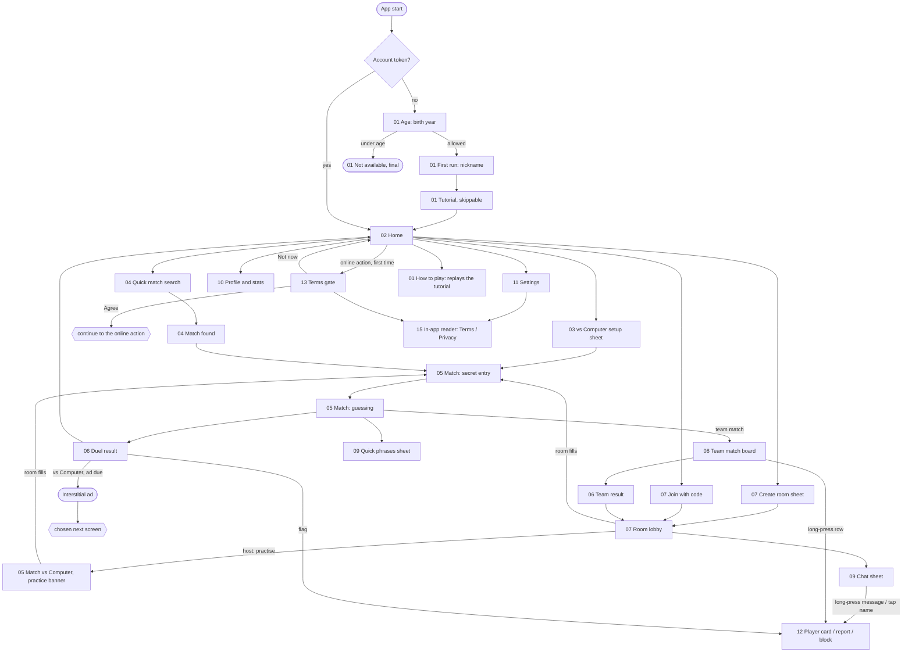

# Navigation map

All screens are specified in this folder; values refer to [`../DESIGN_SYSTEM.md`](../DESIGN_SYSTEM.md) and [`../tokens.json`](../tokens.json). Shots: [`../shots/`](../shots/).

## Rules

- **Back:** system back always goes one level up the tree above. From a running online match, back opens the "leave match?" dialog (05); from the lobby it opens "leave room?"; from Home it leaves the app (no confirmation, no ad).
- **Terms gate** appears before the first online action of an account (quick match, create room, join room, first chat) and again when the Terms version changes. vs Computer never needs it.
- **App only** (owner decision): no screen opens a web page. Terms and the privacy policy are read in-app (15); account deletion is in Settings; deletion without the app is by email (server's static `/delete-account` page, not part of the app).
- **Process death / app switch during a match:** returning within 60 s restores the match screen with the reconnecting banner (14); after 60 s the duel is forfeited and the result screen shows the forfeit line.
- **Deep link** `numbaseball://room/K7Q2M` (and the share link) opens Join with the code filled; Terms gate first if needed.
- **Ads** appear only on Home, results and Profile (DESIGN_SYSTEM section 13). The interstitial is only between a vs-computer result and the next screen.

## Screen index

| # | File | Prototype | Shots |
| --- | --- | --- | --- |
| 01 | [01-first-run.md](01-first-run.md) | `age.html`, `nickname.html` | `age-ko/en`, `age-error-ko`, `age-na-ko`, `nickname-ko`, `nickname-error-ko` |
| 02 | [02-home.md](02-home.md) | `home.html` | `home-ko/de/ru` |
| 03 | [03-vs-computer-setup.md](03-vs-computer-setup.md) | — | — |
| 04 | [04-quick-match.md](04-quick-match.md) | `search.html` | `search-ko`, `search-found-ko` |
| 05 | [05-match.md](05-match.md) | `match.html` | `match-*` |
| 06 | [06-results.md](06-results.md) | `result.html`, `team-board.html?state=final` | `result-*`, `team-final-ko` |
| 07 | [07-room-lobby.md](07-room-lobby.md) | `lobby.html` | `lobby-ko/en/de/ru` |
| 08 | [08-team-board.md](08-team-board.md) | `team-board.html` | `team-board-ko` |
| 09 | [09-chat.md](09-chat.md) | `chat.html`, `match.html?state=phrases` | `chat-*`, `match-phrases-ko` |
| 10 | [10-profile.md](10-profile.md) | — | — |
| 11 | [11-settings.md](11-settings.md) | `settings.html` | `settings-*` |
| 12 | [12-safety-report-block.md](12-safety-report-block.md) | `report.html`, `chat.html?state=actions` | `report-*`, `chat-actions-ko` |
| 13 | [13-terms-gate.md](13-terms-gate.md) | `terms.html` | `terms-ko/en` |
| 15 | [15-legal-reader.md](15-legal-reader.md) | `legal.html` | `legal-ko` |
| 14 | [14-connection-and-errors.md](14-connection-and-errors.md) | `match.html?state=reconnect` | `match-reconnect-ko` |
| — | [ADAPTIVE.md](ADAPTIVE.md) | `match.html` at 360 × 320 | `match-small-ko/de` |
